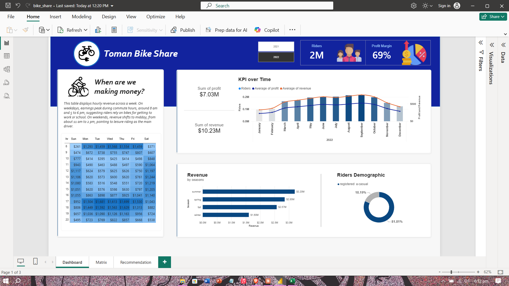
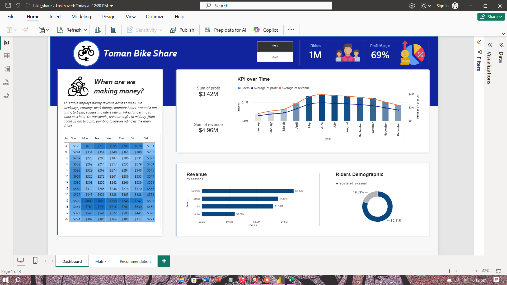
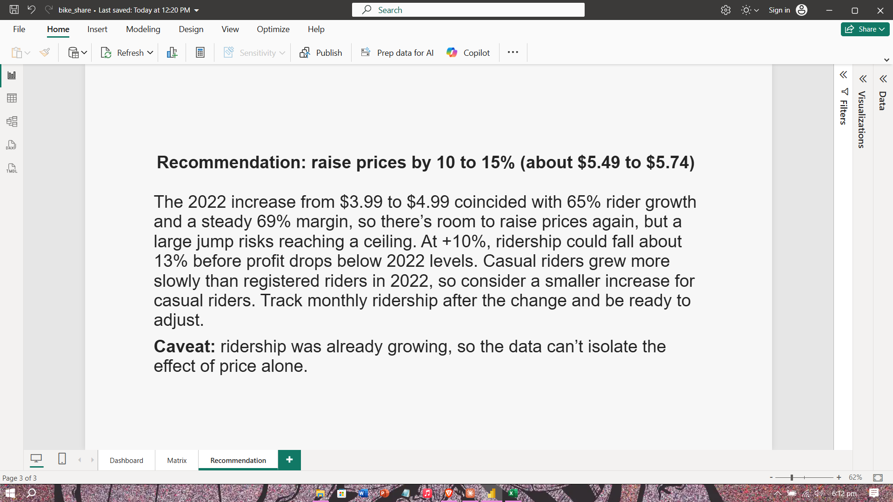

# Toman Bike Share: SQL Server + Power BI Analysis

An end-to-end analysis built from a stakeholder email: combine two years of bike-share ride data in SQL Server, calculate revenue and profit, visualize it in a Power BI dashboard, and answer one business question: **should prices go up next year?**

**Recommendation:** raise prices modestly (about 10 to 15%, or roughly $5.49 to $5.74) and monitor ridership closely. The scenario and workflow follow the Absent Data tutorial; the extensions and the comparison with its recommendation are my own (see [Credits](#credits)).

---

## The Business Request

The request came as an email asking for a dashboard of key performance metrics, a preliminary version as soon as possible, and a recommendation on raising prices next year. No database was supplied, so one was created.

| Request | Where it's answered |
|---|---|
| Hourly revenue analysis | Hour-by-weekday revenue heat map |
| Profit and revenue trends | Monthly trend chart (riders, average profit, average revenue) plus profit and revenue totals |
| Seasonal revenue | Revenue by season bar chart |
| Rider demographics | Registered vs. casual rider donut |
| Easy to navigate, on-brand design | Blue palette and a single year slicer (2021 / 2022) |
| Recommendation on raising prices | Dedicated Recommendation page |

---

## From Raw Data to Dashboard

### Power BI Dashboard: 2022


### Power BI Dashboard: 2021


### Recommendation Page


---

## Overview

The project is built in three layers:

1. **`bike_share_yr_0.csv`, `bike_share_yr_1.csv`, `cost_table.csv`** are the source layer. The first two hold hourly ride counts for 2021 and 2022 by rider type; the cost table holds each year's price and cost of goods sold per ride.
2. **`bike_share_analysis.sql`** is the transformation layer. It stacks both years, joins the cost table, and calculates revenue and profit for every row.
3. **`bike_share.pbix`** is the visualization layer. A Power BI report with a Dashboard page (filterable by year) and a Recommendation page.

---

## How It Works

**Workflow:**

I followed the tutorial's overall workflow for the build, then extended the analysis.

1. **Understood the request.** Read the email and listed the required views and the pricing question.
2. **Set up SQL Server Management Studio** to work in the same Microsoft environment as Power BI.
3. **Created the database and tables** for the 2021 ride data, the 2022 ride data, and the cost table.
4. **Developed the SQL query** that combines both years and calculates revenue and profit.
5. **Connected Power BI to the database.** In Power Query, added conditional columns for the year (0 = 2021, 1 = 2022), season names, and weekday names.
6. **Built the dashboard:** KPI cards, trend chart, revenue by season, rider demographics, hourly heat map, and a year slicer.
7. **Analyzed the results and wrote the recommendation** on a separate report page.

**Data transformation (SQL):**

```sql
WITH cte AS (
    SELECT *
    FROM bike_share_yr_0
    UNION
    SELECT *
    FROM bike_share_yr_1
)

SELECT
    dteday,
    season,
    a.yr,
    weekday,
    hr,
    rider_type,
    riders,
    price,
    COGS,
    riders * price AS revenue,
    (riders * price) - (COGS * riders) AS profit
FROM cte AS a
LEFT JOIN cost_table AS b
    ON a.yr = b.yr
```

- Stacks the 2021 and 2022 tables into one dataset.
- Joins the cost table on `yr` to bring in each year's price and cost per ride.
- Calculates `revenue` as riders x price, and `profit` as revenue minus (cost per ride x riders).

**Power BI measures:**

```
Profit Margin = DIVIDE(SUM(Query1[profit]), SUM(Query1[revenue]))
```

Profit margin is profit divided by revenue, formatted as a percentage. Season and weekday codes were replaced with names using conditional columns in Power Query, and each name column is sorted by its numeric code so the visuals keep calendar order.

---

## Key Findings

| | 2021 | 2022 | Change |
|---|---|---|---|
| Price per ride | $3.99 | $4.99 | +25% |
| Cost per ride | $1.24 | $1.56 | +26% |
| Riders | 1.24M | 2.05M | +65% |
| Revenue | $4.96M | $10.23M | +106% |
| Profit | $3.42M | $7.03M | +106% |
| Profit per ride | $2.75 | $3.43 | +25% |
| Profit margin | about 69% | about 69% | flat |

- **When revenue happens:** on weekdays, revenue peaks at commute hours (around 8 am and 5 to 6 pm). On weekends it shifts to midday, roughly 11 am to 2 pm.
- **Seasonality:** summer is the top revenue season in both years ($1.67M in 2021, $3.20M in 2022), followed by spring, fall, and winter.
- **Rider mix:** registered riders are about 80% of riders in 2021 and about 82% in 2022.

---

## Recommendation

**Raise prices by about 10 to 15% next year and monitor closely.**

- The 2022 increase from $3.99 to $4.99 coincided with 65% rider growth and a steady margin, so demand has not yet shown signs of a price ceiling.
- A break-even check, assuming costs per ride stay at their 2022 level, shows how much room there is:

| Increase | New price | Profit per ride | Ridership could fall by up to |
|---|---|---|---|
| +10% | $5.49 | $3.93 | about 13% |
| +15% | $5.74 | $4.18 | about 18% |

"Could fall by up to" means the drop at which total profit would equal 2022.

- Casual riders' share of ridership fell from 19.9% to 18.2% after the 2022 increase. This may suggest they are more price-sensitive, so a smaller increase for casual riders is worth considering. This is a pattern, not proof.
- Track monthly ridership after the change and adjust if demand weakens.

---

## Comparison with the Tutorial's Recommendation

The tutorial recommends a conservative increase of 10 to 15% (about $5.49 to $5.74), further market research, segmented pricing for casual versus registered riders, and close monitoring after the change.

| | Tutorial | This project |
|---|---|---|
| Recommended increase | 10 to 15% | 10 to 15% |
| Basis for the range | Avoid hitting a price ceiling where demand starts to drop | Break-even check: ridership could fall about 13% at +10% and about 18% at +15% before profit drops below 2022 |
| Segmented pricing | Suggested as an idea | Supported by a data point: casual riders' share fell from 19.9% to 18.2% after the 2022 increase |
| Next steps | Market research, then monitor and adjust | Monitor monthly ridership and adjust, noting that the data cannot isolate the effect of price |

Both reach the same range. The difference is that I tried to quantify how much demand loss each level could absorb and checked the data for a hint about segmentation.

---

## What I Added Beyond the Tutorial

| Issue or gap | What I did |
|---|---|
| Profit margin showed 0.45, which didn't match $3.42M profit on $4.96M revenue | Checked the numbers by hand and rewrote the measure as profit divided by revenue; it now shows about 69% |
| Weekday labels were shifted by one day (commute peaks appeared under the wrong days) | Compared weekday and weekend hourly patterns, then remapped the labels so 0 = Sunday |
| Season and weekday were numeric codes, and text labels sorted alphabetically | Added name columns and sorted each by its numeric code |
| The hourly matrix was hard to scan | Added a heat map so the peaks are visible at a glance |
| The recommendation range had no numbers behind it | Added a break-even analysis for the 10 to 15% range |
| Segmented pricing was only an idea | Compared casual and registered rider shares across the two years as a lead |

---

## Files in This Repository

| File | Description |
|------|-------------|
| `bike_share_analysis.sql` | SQL Server query that combines both years and calculates revenue and profit |
| `bike_share.pbix` | Power BI report (open with Power BI Desktop, which is free) |
| `bike_share_yr_0.csv` | Hourly ride data for 2021 |
| `bike_share_yr_1.csv` | Hourly ride data for 2022 |
| `cost_table.csv` | Price and cost of goods sold per ride, by year |
| `dashboard-2021.png` | Screenshot: dashboard filtered to 2021 |
| `dashboard-2022.png` | Screenshot: dashboard filtered to 2022 |
| `recommendation.png` | Screenshot: Recommendation page |

The `.pbix` connects to a local SQL Server database. To refresh it on another machine, recreate the tables from the CSV files and update the data source.

---

## A Note on the Data

This is a tutorial dataset, so the prices and results may be synthetic and should be read as an exercise, not as real company performance.

- **One price change:** ridership was already growing, so the data cannot isolate the effect of price alone.
- **Break-even assumption:** the estimate assumes costs per ride stay flat.
- **Weekday field:** the `weekday` column does not line up with the calendar dates (for example, 2021-01-01 is tagged as weekday 6, but that date was a Friday). Weekday labels follow the dataset's own `weekday` field, where 0 is Sunday.

---

## Tools Used

- **SQL Server (SSMS)**: database and table setup, data transformation query
- **Microsoft Power BI**: Power Query transformations, DAX measures, dashboard design

---

## Credits

- **Scenario and workflow:** the "End-to-End Data Analysis Project 2024 | SQL & Power BI" tutorial by Absent Data. I followed its workflow for the build.
- **Data:** [YT_bike_share](https://github.com/Gaelim/YT_bike_share) on GitHub.
- **My own work:** the extensions listed in [What I Added Beyond the Tutorial](#what-i-added-beyond-the-tutorial) and the comparison above.

---

## About

Built by **John Martin S. Villena**, BS Information Technology graduate (Business Analytics) from Bulacan State University.

🔗 [LinkedIn](https://www.linkedin.com/in/jhnmrtnvlln/)
💻 [GitHub](https://github.com/jhnmrtnvlln)
